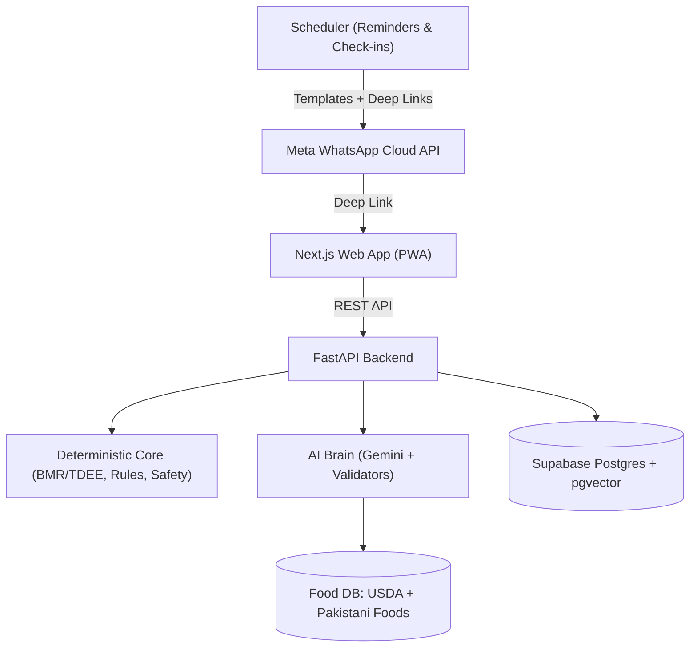

# FitSoul AI

[](https://github.com/Aymen472/fitsoul-ai/actions/workflows/ci.yml)

**Your 24/7 AI Nutritionist, Fitness Coach, and Emotional Support Companion** — built for Pakistani and South Asian lifestyles (PCOS, Type-2 diabetes, weight loss, brides/grooms, and busy professionals).

## Architecture (Hybrid Channel Strategy)

Main chat, full persistent history, dashboard, and workout player live in our **Next.js PWA**. **WhatsApp** is used strictly for proactive notifications (approved templates + deep links back to the app). See [ADR-001](docs/04_ARCHITECTURE_DECISIONS.md).



## Core Principles

1. **Deterministic numbers:** Calories, macros, BMR, and TDEE are always computed by Python code and the verified food database — never invented by the LLM.
2. **Safety guardrails:** Hard calorie floors (female ≥ 1200 kcal, male ≥ 1500 kcal), condition-specific rules (PCOS, diabetes, hypertension), zero prescription medicine suggestions, whitelist-only supplements, and eating-disorder/self-harm detection.
3. **Culturally aware:** Designed around South Asian meals (roti, daal, sabzi, karahi, chai) and Roman Urdu / English communication.

## Tech Stack

- **Backend:** Python 3.12, FastAPI, Pydantic, Supabase (Postgres + pgvector), Google Gemini API
- **Frontend:** Next.js, TypeScript, Tailwind CSS, shadcn/ui *(Phase 3)*
- **Tooling:** `uv`, `ruff`, `pytest`, `pre-commit`, GitHub Actions

## Local Setup (Backend)

1. **Clone the repository:**
   ```bash
   git clone https://github.com/Aymen472/fitsoul-ai.git
   cd fitsoul-ai
   ```
2. **Create your `.env` file:**
   ```bash
   cp .env.example .env
   ```
3. **Install backend dependencies with `uv`:**
   ```bash
   cd backend
   uv sync --python 3.12
   ```
4. **Run the FastAPI server:**
   ```bash
   uv run uvicorn app.main:app --reload
   ```
   Verify at `http://127.0.0.1:8000/health` → `{"status": "ok"}`.
5. **Run tests and linter:**
   ```bash
   uv run pytest
   uv run ruff check .
   uv run ruff format --check .
   ```

*(Optional)* Install pre-commit hooks from the repo root:
```bash
uv run --project backend pre-commit install
```

## Roadmap

- [x] Planning & architecture docs (`docs/01`–`04`)
- [x] **Phase 0:** Repo setup, FastAPI `/health`, ruff, pytest, pre-commit, CI
- [ ] **Phase 1:** Deterministic nutrition engine, Pakistani food DB, user profile, Supabase schema
- [ ] **Phase 2:** AI brain (meal planner + validator, photo scanner, safety guardrails, coach persona)
- [ ] **Phase 3:** Next.js PWA (auth, chat with history, dashboard, workout & face yoga player)
- [ ] **Phase 4:** WhatsApp notifications (webhook, approved templates, scheduler)
- [ ] **Phase 5:** Payments, admin panel, beta launch
- [ ] **Phase 6:** Native mobile app (steps tracking), scale

## Documentation

- [Project Overview](docs/01_PROJECT_OVERVIEW.md)
- [Development Roadmap](docs/02_DEVELOPMENT_ROADMAP.md)
- [Best Practices](docs/03_BEST_PRACTICES.md)
- [Architecture Decisions (ADR-001)](docs/04_ARCHITECTURE_DECISIONS.md)
- [Progress Log](docs/PROGRESS.md)

## Medical Disclaimer

FitSoul AI provides general nutrition, fitness, and lifestyle guidance. It is **not** a substitute for professional medical advice, diagnosis, or treatment. Always consult a qualified doctor or certified dietitian before making major dietary or health changes, especially if you have a medical condition or take regular medication.
