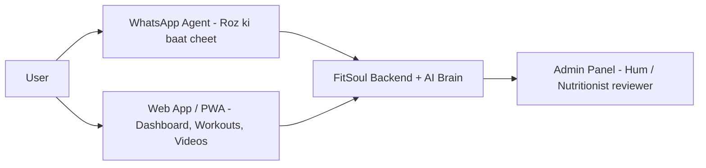
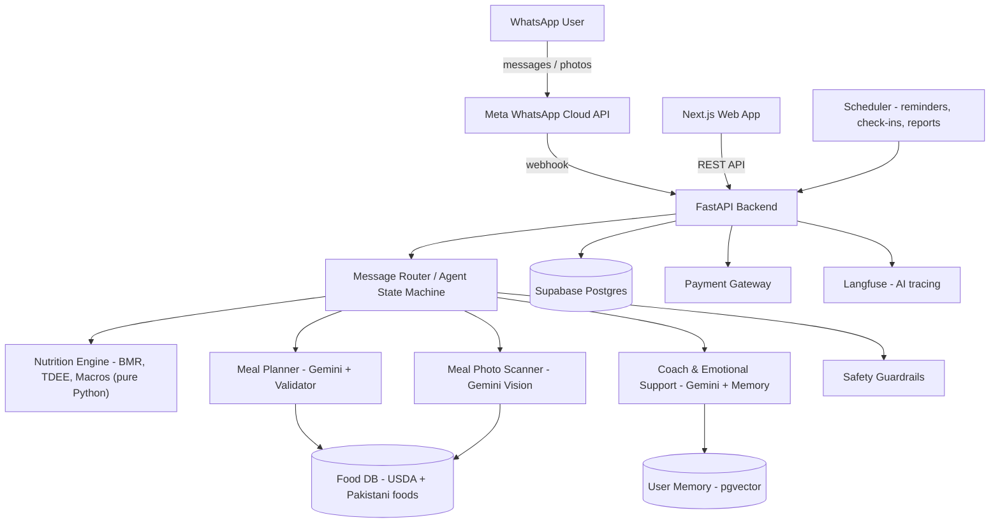

# FitSoul AI — Project Overview Document

> **Tagline:** *"Aapka 24/7 AI Nutritionist, Fitness Coach aur Emotional Support Companion — WhatsApp par."*
>
> **Version:** 1.0 (Idea & Product Specification)
> **Status:** Planning / Pre-development

---

## 1. Introduction

### 1.1 Problem Kya Hai?
Aaj kal har doosra banda apne weight, health aur looks ke baare mein conscious hai, lekin:

| Masla | Detail |
| :--- | :--- |
| **Nutritionist mehenga hai** | Ek achha nutritionist Rs. 10,000 – 30,000/month leta hai aur hafte mein sirf 1 dafa baat karta hai. |
| **Generic diet plans kaam nahi karte** | Internet ke plans PCOS, Diabetes, Thyroid ya desi khane ko consider nahi karte. |
| **Calorie tracking boring hai** | MyFitnessPal jaisi apps mein har cheez manually type karni parti hai — log 1 hafte mein chor dete hain. |
| **Accountability nahi hoti** | Koi roz poochne wala nahi hota "aaj workout kiya?" — is liye motivation khatam ho jati hai. |
| **Emotional eating & guilt** | Log diet plan ki kami se nahi, balki stress, guilt aur loneliness ki wajah se fail hote hain. |

### 1.2 Hamara Solution
**FitSoul AI** ek AI-powered wellness companion hai jo:
1. User ki **personal profile** (age, height, weight, gender, medical condition, food preference) ke hisab se **scientifically calculated** diet plan banata hai.
2. **WhatsApp par** roz meal options, reminders aur check-ins bhejta hai — koi nayi app seekhni nahi parti.
3. **Khane ki photo** dekh kar calories aur macros estimate karta hai.
4. **Workouts aur Face Yoga** guided videos + timer ke sath karwata hai.
5. **Bina judge kiye** emotional support deta hai — jaise ek dost jo nutritionist bhi ho.

### 1.3 Vision
> Pakistan aur South Asia ka **pehla culturally-aware AI wellness coach** banna jo desi khana, desi lifestyle aur Roman Urdu samajhta ho — aur har us insaan ke liye affordable ho jo professional nutritionist afford nahi kar sakta.

---

## 2. Target Audience (Kis Ko Bechenge?)

| Priority | Segment | Kyun Khareedenge? |
| :---: | :--- | :--- |
| 🥇 | **PCOS / Hormonal weight gain wali khawateen (18–35)** | Bohat bara segment, desperate for guidance, normal trainers ko PCOS diet ka pata nahi hota. |
| 🥈 | **Brides / Grooms-to-be** | Time-bound goal ("3 mahine mein shaadi hai"), pay karne ki high willingness. |
| 🥉 | **Busy professionals & desk workers (25–40)** | Gym ka waqt nahi, ghar ka khana khate hain, simple guidance chahiye. |
| 4 | **Type-2 Diabetes / Pre-diabetic log** | Strict diet chahiye, family members bhi unke liye subscribe karte hain. |
| 5 | **Overseas Pakistanis (UAE, Saudi, UK)** | Desi khana + foreign income = high-paying customers. |

---

## 3. Product Kya Hoga? (Hum Users Ko Kya Bechenge)

Hum users ko **ek subscription service** bechenge — "AI Personal Nutritionist & Coach". Is ke **3 touchpoints** honge:

### 3.1 WhatsApp AI Agent (Main Product — Phase 1)
- Ek **WhatsApp Business number** hoga (e.g. +92 3XX FITSOUL).
- User us number par message karega aur AI agent jawab dega.
- **Kyun WhatsApp?** Pakistan mein har banda WhatsApp use karta hai; nayi app download karwana mushkil hota hai. Conversion rate bohat zyada hota hai.
- Yahan hoga: meal reminders, photo se calorie tracking, paani reminders, craving support, check-ins, payment reminders.

### 3.2 Web App / PWA (Companion Dashboard — Phase 1 & 2)
WhatsApp par videos/timer/graphs achhe nahi chalte, is liye ek **mobile-friendly web app** (install bhi ho sakti hai bina Play Store ke):
- Progress graphs (weight, calories, streaks)
- Workout player (animated exercises + timer + voice cues)
- Face yoga routines
- Weekly meal plan aur grocery list
- Subscription / billing

### 3.3 Native Mobile App (Phase 3 — jab users barh jayein)
- Flutter / React Native app — Play Store & App Store par.
- Push notifications, offline workouts, health app sync (Google Fit / Apple Health).

### 3.4 Pricing Plan

| Plan | Price | Kya Milega |
| :--- | :--- | :--- |
| **Free Trial** | 7 din free | Complete plan + WhatsApp coaching (aadat lagwane ke liye) |
| **Basic** | Rs. 1,499/mo | Diet plan, meal reminders, text-based tracking, water reminders |
| **Pro** ⭐ | Rs. 2,999/mo | Sab kuch + photo meal scanning, workouts, face yoga, emotional support, weekly AI report |
| **Transformation (3 months)** | Rs. 6,999 | Pro + goal-deadline roadmap (bride/groom packages) |
| **Overseas** | \$9.99/mo | Pro plan for international users |

> [!TIP]
> Future mein **"Human + AI" premium plan** (Rs. 7,000+/mo) bhi add kar sakte hain jahan ek real certified nutritionist hafte mein ek dafa AI ke plan ko review kare.

---

## 4. Features — Detail Mein (Kya Karega, Kaise Karega, Kaise Helpful Hai)

### Feature 1: Smart Onboarding & Health Profiling
- **Kya karta hai:** User se 2 minute mein basic info leta hai — age, gender, height, weight, goal, target deadline, activity level, medical conditions (PCOS, Diabetes, Thyroid, BP), allergies, food preference (desi, veg, non-veg), budget.
- **Kaise kaam karta hai:** WhatsApp par quick-reply buttons / interactive list messages, ya web form. Data database mein save hota hai.
- **Kaise helpful hai:** Har banda ka plan us ki apni body aur situation ke mutabiq banta hai — "one-size-fits-all" nahi.

### Feature 2: Clinical Nutrition Engine (Calories & Macros)
- **Kya karta hai:** User ki daily calorie aur protein/carbs/fat target calculate karta hai.
- **Kaise kaam karta hai:**
  - **BMR** — Mifflin-St Jeor equation (Python code, AI nahi):
    $$BMR = 10W + 6.25H - 5A + s$$
    (W = kg, H = cm, A = age, s = +5 male / −161 female)
  - **TDEE** = BMR × activity factor (1.2 – 1.9)
  - **Goal adjustment** — weight loss ke liye 300–500 kcal deficit (minimum safe floor: female ~1200, male ~1500 kcal).
  - **Condition rules** — PCOS: low-GI, moderate carbs, high protein/fiber. Diabetes: carb cap, no refined sugar.
- **Kaise helpful hai:** Numbers **deterministic aur verifiable** hain — AI ghalat calculation nahi kar sakta.

### Feature 3: AI Personalized Meal Planner
- **Kya karta hai:** Daily / weekly meal plan banata hai (breakfast, lunch, snacks, dinner) jo calorie target aur medical rules se match ho.
- **Kaise kaam karta hai:** AI (Gemini) ko verified food database (USDA + Pakistani food table) se foods diye jate hain; AI combination chunta hai; phir **Python validator** check karta hai ke calories ±5% match hain aur koi forbidden food nahi hai. Fail ho to dobara generate.
- **Kaise helpful hai:** Desi, sasta, ghar mein banne wala khana — "quinoa aur avocado" nahi, balki "daal, roti, chicken karahi, raita".
- **Extra:** Weekly grocery list auto-generate.

### Feature 4: Snap & Track (Photo Meal Scanner)
- **Kya karta hai:** User plate ki photo bheje → AI food items pehchane, portion estimate kare, calories/macros bataye.
- **Kaise kaam karta hai:** Gemini multimodal vision → structured JSON (food name, portion, grams) → nutrition values **database se** lookup (AI ke guess se nahi) → daily log update.
- **Kaise helpful hai:** 5 second ka kaam — manual typing khatam. User confirm/edit kar sakta hai ("yeh 2 roti thi, 1 nahi").

### Feature 5: Smart Swap & Eating-Out Assistant
- **Kya karta hai:** "Dawat mein biryani hai, kya karun?" ya restaurant menu ki photo → best option + portion advice.
- **Kaise helpful hai:** Social life chhore baghair diet chalti rehti hai.

### Feature 6: Healthy Snacks Engine
- **Kya karta hai:** Chai-time aur craving ke waqt 2–3 desi healthy snack options deta hai (bhune chanay, makhana, boiled egg, fruit + peanut butter, dahi).
- **Kaise helpful hai:** Biscuit/chips ki aadat ko healthy swaps se replace karta hai.

### Feature 7: Hydration & Habit Reminders
- **Kya karta hai:** Body weight ke hisab se paani ka target (~30–35 ml/kg), din bhar smart reminders, ek tap se log.
- **Kaise kaam karta hai:** Background scheduler user ke timezone aur sleep schedule ke mutabiq messages bhejta hai (raat ko disturb nahi karta).

### Feature 8: Workout Plans with Guided Player
- **Kya karta hai:** Level ke hisab se 15–40 min home/gym workouts. Animated exercise demos, countdown timer, rest timer, voice cues.
- **Kaise kaam karta hai:** Exercises ek **pre-built exercise library** se aati hain (licensed animations / ExerciseDB jaisi API / apni recorded videos). AI user ke level, injuries aur available waqt ke hisab se routine compose karta hai.
- **Adaptive:** "Knee pain" ya "too hard" tap karne par alternative exercise.
- **Kaise helpful hai:** Gym ki zaroorat nahi, ghar par trainer jaisa experience.

> [!NOTE]
> "AI generated character" har user ke liye real-time generate karna mehenga aur slow hai. Behtar tareeqa: **ek dafa** apna branded 3D/animated character bana kar har exercise ki loop video library mein rakh lein, phir app usay reuse kare.

### Feature 9: Face Yoga & Glow-Up Routines
- **Kya karta hai:** Double chin, jawline, cheek lift, neck posture ke liye 5–7 min daily routines (animated GIF + timer).
- **Kaise helpful hai:** Viral, fun, aur ladies segment mein bohat demand. Marketing (TikTok/Reels) ke liye zabardast content.
- **Honest note:** Face exercises ke results limited/variable hote hain — app inhe "posture & wellness routine" ke tor par present kare, guaranteed fat-loss claim na kare.

### Feature 10: Supplement Guidance (Safe Mode)
- **Kya karta hai:** General, evidence-based OTC supplements ke baare mein **information** deta hai (Vitamin D, Omega-3, Magnesium, PCOS ke liye Inositol).
- **Safety rules:**
  - Koi prescription medicine kabhi suggest nahi hogi.
  - Har suggestion ke sath "doctor se confirm karein" note.
  - Pregnancy, kidney/liver disease, ya regular medication wale users ke liye supplement suggestions **off**.
- **Kaise helpful hai:** Users ko confusion aur fake products se bachata hai.

### Feature 11: Emotional Support & Psychology Layer (Secret Sauce ❤️)
- **Kya karta hai:**
  - **No-guilt responses** — cheat meal par shame nahi, recovery plan.
  - **Emotional trigger tracking** — AI notice karta hai user kab overeat karta hai (raat ko, stress mein, periods mein) aur pehle se proactive support deta hai.
  - **Micro-wins celebration** — streaks, badges, "I'm proud of you" messages.
  - **Mood check-ins** — "Aaj kaisa feel ho raha hai?" (1-tap emoji).
- **Kaise kaam karta hai:** Long-term memory (user ke patterns database mein), empathetic system prompt, behavioral psychology techniques (habit stacking, positive reinforcement, motivational interviewing).
- **Safety:** Agar user eating disorder, self-harm ya severe depression ke signs dikhaye → AI diet advice rok de, gently professional help aur helpline suggest kare.

### Feature 12: Smart Cheat Day System
- **Kya karta hai:** Cheat day "earn" hota hai — hafte mein ~85% adherence par weekend treat meal unlock.
- **Kaise helpful hai:** Restriction ka pressure kam, motivation zyada.

### Feature 13: Progress Tracking & Weekly AI Report
- **Kya karta hai:** Weight, measurements (optional), progress photos (private), calories, workouts, mood — sab graphs mein.
- **Weekly report (Sunday):** "Is hafte 0.6 kg kam hua, consistency 82%, protein thora kam raha, next week ka focus: ..."
- **Plateau detection:** 2–3 hafte weight stuck ho to plan auto-adjust.

### Feature 14: Subscription & Payments
- Trial → paid conversion, renewal reminders 3 din pehle, payment link WhatsApp par.
- Local payments: **JazzCash, Easypaisa, Safepay / PayFast** (cards). International: **LemonSqueezy / Paddle**.

### Feature 15: Admin Panel (Hamare Liye)
- Users list, subscriptions, revenue, flagged conversations (safety), AI cost tracking, food database management.

---

## 5. User Ka Ek Din (Daily Journey)

| Waqt | Kya Hota Hai | User Ka Time |
| :--- | :--- | :---: |
| 08:00 AM | Good morning + aaj ka breakfast option | 5 sec |
| 08:20 AM | Breakfast ki photo bheji → calories logged | 5 sec |
| 08:30 AM | 5-min face yoga (optional) | 5 min |
| 11:00 AM | Paani reminder (1 tap) | 2 sec |
| 01:00 PM | Lunch ke 2 options | 5 sec |
| 04:30 PM | Chai-time snack idea | 5 sec |
| 06:30 PM | 20-min workout link (web player) | 20 min |
| 08:30 PM | Dinner photo | 5 sec |
| 10:30 PM | Din ka summary + kal ka preview + mood check | 10 sec |

> Normal din mein chat sirf **2–3 minute**. Lambi baat sirf tab jab user ko zaroorat ho (craving, party, low mood).

---

## 6. Tools & Technologies

| Layer | Technology | Kyun |
| :--- | :--- | :--- |
| **Language** | Python 3.12 (backend), TypeScript (frontend) | AI ecosystem Python mein sab se strong |
| **Backend API** | FastAPI | Fast, async, auto API docs |
| **AI Models** | Google Gemini API (Flash for chat & vision, Pro for weekly reports) | Sasta, multimodal, Urdu samajhta hai |
| **Structured Output** | Pydantic + Gemini JSON schema mode | AI ka output hamesha valid format mein |
| **Agent Logic** | LangGraph (ya simple custom state machine) | Onboarding → coaching → support states |
| **Database** | PostgreSQL via **Supabase** | Free tier, auth, storage, row-level security |
| **Vector Search** | pgvector (Supabase ke andar) | Clinical guidelines RAG + user memory |
| **File Storage** | Supabase Storage | Meal photos, progress photos (private) |
| **Background Jobs** | APScheduler (shuru mein) → Celery + Redis (scale par) | Reminders, check-ins, weekly reports |
| **WhatsApp** | **Meta WhatsApp Cloud API** (direct) ya Twilio | Official, reliable |
| **Frontend / PWA** | Next.js + Tailwind CSS + shadcn/ui | Modern, fast, mobile-friendly |
| **Charts** | Recharts | Progress graphs |
| **Nutrition Data** | USDA FoodData Central API (free) + apna **Pakistani food table** | Verified calorie data |
| **Exercise Media** | Licensed exercise animation library / ExerciseDB API / apni videos | Workout player |
| **Payments** | Safepay / PayFast / JazzCash / Easypaisa; LemonSqueezy (international) | Pakistan mein Stripe direct available nahi |
| **AI Observability** | Langfuse (open-source) | Har AI call ka cost, latency, quality trace |
| **Testing** | pytest, Playwright (frontend) | Quality |
| **CI/CD** | GitHub Actions | Har push par auto tests |
| **Deployment** | Backend: Render / Railway / Fly.io · Frontend: Vercel | Free/cheap tiers |
| **Containers** | Docker + docker-compose | Same environment har jagah |

---

## 7. System Architecture

---

## 8. Safety, Privacy & Legal

1. **Medical disclaimer** — onboarding aur website par: "FitSoul AI lifestyle aur nutrition guidance deta hai; yeh doctor ki prescription ka substitute nahi."
2. **High-risk users** — pregnancy, BMI < 18.5, eating disorder history, kidney disease, Type-1 diabetes, under-18 → limited mode + doctor se rabta karne ka mashwara.
3. **Hard-coded guardrails** — minimum calorie floor, forbidden foods per condition, no medicine advice.
4. **Privacy** — health data sensitive hai: encryption, row-level security, progress photos private, data delete karne ka option, clear privacy policy.
5. **WhatsApp policy compliance** — Meta Business policies follow karna, users ka opt-in lena, template messages approve karwana.
6. **Expert review** — launch se pehle ek certified nutritionist/dietitian se meal rules aur food table review karwana (credibility + marketing: "Reviewed by certified nutritionist").

---

## 9. Business Model & Profit

### 9.1 Cost per User (estimate)
| Item | Monthly / User |
| :--- | :--- |
| Gemini API (chat + ~60 photos) | ~Rs. 50 – 150 |
| WhatsApp conversation charges | ~Rs. 100 – 250 |
| Hosting/DB (shared) | ~Rs. 30 – 50 |
| **Total** | **~Rs. 200 – 450** |

Pro plan Rs. 2,999 par **~85% gross margin**.

> [!NOTE]
> Yeh estimates hain — actual WhatsApp aur Gemini pricing launch se pehle official websites par check karni hogi, kyunki rates change hote rehte hain.

### 9.2 Revenue Projection (simple)
| Paying Users | Monthly Revenue (avg Rs. 2,500) |
| :---: | :---: |
| 50 | Rs. 125,000 |
| 200 | Rs. 500,000 |
| 1,000 | Rs. 2,500,000 |

### 9.3 Extra Revenue Streams (future)
- Affiliate: healthy snacks / supplement brands / fitness gear.
- Corporate wellness packages (companies apne employees ke liye).
- Gym & nutritionist partnerships (B2B white-label — original CoachSync idea).
- Paid challenges ("30-day PCOS reset", "Bride glow-up program").

---

## 10. Marketing & Growth Strategy
1. **Content-led:** TikTok/Instagram Reels — desi healthy swaps, face yoga, "AI ne meri plate ki calories batayin" demos.
2. **Community:** PCOS support groups, bride groups on Facebook.
3. **Referral:** "Dost ko lao, dono ko 1 hafta free".
4. **Micro-influencers:** Fitness & lifestyle creators ko free Pro access + affiliate commission.
5. **Before/After stories** (user ki permission ke sath).

---

## 11. Competitors & Hamara Edge

| Competitor | Kami | FitSoul Edge |
| :--- | :--- | :--- |
| MyFitnessPal | Manual logging, desi food data kamzor, no coaching | Photo scan, desi DB, WhatsApp coach |
| HealthifyMe | Indian-focused, mehenga human coach | Pakistani context, Roman Urdu, affordable |
| Local nutritionists | Mehenge, limited availability | 24/7, 1/5 price |
| ChatGPT directly | No tracking, no reminders, no safety rules | Proactive, verified data, memory |

---

## 12. Success Metrics (KPIs)
- Trial → Paid conversion rate (target: 15–25%)
- Day-7 / Day-30 retention
- Daily active logging rate
- Average weight progress per user
- AI cost per active user
- NPS / user satisfaction

---

## 13. Glossary
- **BMR:** Basal Metabolic Rate — aaram ki halat mein body jitni calories jalati hai.
- **TDEE:** Total Daily Energy Expenditure — pure din ki total calories.
- **Macros:** Protein, Carbohydrates, Fats.
- **GI (Glycemic Index):** Khana kitni tezi se blood sugar barhata hai.
- **RAG:** Retrieval-Augmented Generation — AI ko verified documents se jawab dilwana.
- **PWA:** Progressive Web App — website jo phone par app ki tarah install ho jaye.
- **MVP:** Minimum Viable Product — sab se chota version jo launch ho sake.
