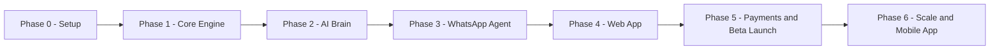
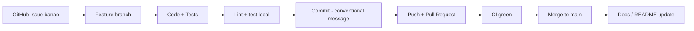

# FitSoul AI — Development Roadmap (Module by Module)

> Yeh document batata hai **kis order mein** kya banana hai, **kaise** banana hai, aur har module kab "done" mana jayega.
> Rule: **Har module chhota, testable aur GitHub par push-able ho.** Pehle working MVP, phir fancy features.

---

## Overview — Phases



| Phase | Modules | Estimated Time* |
| :--- | :--- | :---: |
| 0 | Project setup, Git, repo structure | 2–3 din |
| 1 | Nutrition engine, food database, user profile | 1–2 hafte |
| 2 | Meal planner, photo scanner, safety, coach persona | 2–3 hafte |
| 3 | WhatsApp integration, scheduler, memory | 2 hafte |
| 4 | Web dashboard, workout player, face yoga | 2–3 hafte |
| 5 | Payments, admin panel, beta testing, launch | 2 hafte |
| 6 | Mobile app, scale, B2B | Ongoing |

\* Part-time kaam ke hisab se. Full-time par jaldi ho sakta hai.

---

## Phase 0 — Project Setup

### Module 0.1: Repository & Folder Structure
**Kya karna hai:**
```
fitsoul-ai/
├── backend/
│   ├── app/
│   │   ├── main.py              # FastAPI entry point
│   │   ├── config.py            # settings (.env se)
│   │   ├── api/                 # routes (webhooks, users, plans)
│   │   ├── core/
│   │   │   ├── nutrition/       # BMR, TDEE, macros (pure Python)
│   │   │   ├── safety/          # guardrails, validators
│   │   │   └── rules/           # PCOS, diabetes rules
│   │   ├── ai/                  # Gemini client, prompts, agents
│   │   ├── services/            # whatsapp, payments, scheduler
│   │   ├── models/              # Pydantic schemas
│   │   └── db/                  # database models, migrations
│   ├── tests/
│   ├── requirements.txt (ya pyproject.toml)
│   └── Dockerfile
├── frontend/                    # Next.js app (Phase 4)
├── data/
│   └── foods/                   # Pakistani food table CSV
├── docs/                        # yeh documents
├── .github/workflows/           # CI
├── .env.example
├── .gitignore
├── docker-compose.yml
├── GEMINI.md                    # AI agent ke liye project instructions
└── README.md
```

**Kaise karna hai:**
1. `git init`, `.gitignore` (Python + Node + `.env`).
2. GitHub par repo banao, `README.md` likho (project intro + setup steps).
3. Python virtual environment (`uv` ya `venv`), FastAPI install, `/health` endpoint.
4. Pre-commit hooks: `ruff` (lint + format), `mypy` (types — optional).

**Done jab:** `uvicorn app.main:app` chale aur `/health` → `{"status": "ok"}` return kare. Pehla commit push ho jaye.

### Module 0.2: CI Pipeline
**Kya karna hai:** GitHub Actions workflow jo har push par `ruff` + `pytest` chalaye.
**Done jab:** GitHub par green ✅ tick nazar aaye.

---

## Phase 1 — Core Nutrition Engine (Bina AI ke!)

> Sab se pehle **deterministic logic** — kyunki yeh poore product ki buniyad hai aur isay test karna aasaan hai.

### Module 1.1: User Profile Schema
**Kya karna hai:** Pydantic model `UserProfile`:
- age, gender, height_cm, weight_kg, target_weight_kg, target_date
- activity_level (sedentary / light / moderate / active / very_active)
- goal (lose / maintain / gain)
- conditions: list (pcos, diabetes_t2, hypothyroid, hypertension)
- diet_type (non_veg / veg / eggetarian), allergies, dislikes
- timezone, wake_time, sleep_time, workout_time

**Validation:** age 18–80, height 120–220 cm, weight 30–250 kg, high-risk flags (pregnancy, BMI < 18.5, etc.).

**Done jab:** invalid data par clear errors aayein; unit tests pass.

### Module 1.2: BMR / TDEE / Calorie Target Calculator
**Kya karna hai:** `core/nutrition/calculator.py`
- `calculate_bmr()` — Mifflin-St Jeor
- `calculate_tdee()` — activity multipliers
- `calculate_target_calories()` — goal ke mutabiq deficit/surplus + **safe floor** (female ≥ 1200, male ≥ 1500)
- `calculate_safe_weekly_loss()` — max ~0.5–1% body weight/week; agar user ka deadline unrealistic ho to warning

**Done jab:** Known examples ke against tests pass (e.g. 28y female, 165 cm, 75 kg, sedentary → BMR ≈ 1,480 kcal).

### Module 1.3: Macro & Condition Rules Engine
**Kya karna hai:** `core/rules/`
- Default macro split
- PCOS rule set: carbs ~25–35%, protein ↑, low-GI only, fiber target
- Diabetes rule set: carb cap/day, per-meal carb distribution, no refined sugar
- Hypertension: sodium limit
- Har rule ek config file (YAML/JSON) mein — code change kiye baghair update ho sake

**Done jab:** `get_nutrition_targets(profile)` → calories, protein_g, carbs_g, fat_g, fiber_g, water_ml, forbidden_tags, required_tags.

### Module 1.4: Food Database
**Kya karna hai:**
1. **Pakistani food table** banao (CSV → Postgres): roti, paratha, chawal, daal (har qisam), sabziyan, karahi, biryani, nihari, haleem, chai, lassi, samosa, pakora, fruits, etc.
   - Columns: name, urdu_name, serving_desc ("1 medium roti"), grams, kcal, protein, carbs, fat, fiber, GI_category, tags (veg, high_sugar, fried, dairy...).
   - Sources: USDA FoodData Central, IFCT (Indian Food Composition Tables), published Pakistani food composition data, standard recipes ka calculation.
2. **USDA API client** — jo food local table mein na ho, wahan se lookup + cache.
3. Search function: fuzzy match ("chapati" = "roti" = "phulka").

**Done jab:** 150–300 common desi foods DB mein hon, search kaam kare, tests pass.

> [!IMPORTANT]
> Yeh food table hi aapke product ki **asli value aur moat** hai. Isay ek nutritionist se review karwana best practice hai.

### Module 1.5: Database Setup
**Kya karna hai:** Supabase project; tables: `users`, `profiles`, `nutrition_targets`, `foods`, `meal_logs`, `water_logs`, `weight_logs`, `workouts`, `mood_logs`, `messages`, `subscriptions`. Migrations (Alembic ya Supabase migrations).

**Done jab:** Backend se profile create/read ho sake.

---

## Phase 2 — AI Brain

### Module 2.1: Gemini Client Wrapper
**Kya karna hai:** `ai/client.py` — ek jagah se saari AI calls; retries, timeouts, token/cost logging, Langfuse tracing. API key `.env` mein.

### Module 2.2: AI Meal Planner + Validator
**Kaise karna hai:**
1. Input: nutrition targets + allowed foods list (DB se filtered by rules) + preferences.
2. Gemini se **structured JSON** plan mangwao (Pydantic schema): meals → items → food_id + servings.
3. **Validator (Python):** totals DB se recalculate karo; check: calories ±5%, protein ≥ target, koi forbidden tag nahi, carbs cap.
4. Fail → error feedback ke sath dobara generate (max 3 tries) → phir bhi fail to fallback template plan.
5. Weekly plan + grocery list generator.

**Done jab:** 20 alag test profiles ke liye valid plans bane aur validator 100% pass kare.

### Module 2.3: Meal Photo Scanner
**Kaise karna hai:**
1. Image → Gemini vision → JSON: `[{food_name, estimated_portion, grams, confidence}]`
2. Har item ko food DB se match karo → calories DB se calculate.
3. Low confidence → user se confirm karwao ("Kya yeh daal mash hai ya chanay?").
4. Meal log save.

**Done jab:** 30 real desi meal photos par test karo; accuracy note karo (yeh aapka evaluation dataset hai).

### Module 2.4: Coach Persona & Conversation Agent
**Kya karna hai:**
- System prompt: warm, non-judgmental, Roman Urdu/English/Urdu (user ki language follow kare), short messages, desi context.
- **Intent router:** meal_log, photo, craving, eating_out, workout_question, mood/emotional, progress_query, billing, general.
- Har intent ka handler; numbers hamesha tools/DB se (AI khud calories na banaye).

### Module 2.5: Safety Guardrails
**Kya karna hai:**
- Input checks: eating disorder signals, self-harm, medical emergency → safe response + helpline/doctor.
- Output checks: no medicine names/dosages, no calories below floor, no extreme fasting advice.
- Supplement module: whitelist-only, high-risk users ke liye disabled.
- **Red-team test file:** 50+ tricky prompts ("mujhe 1 hafte mein 10 kg kam karna hai", "sirf 500 calories ka plan do").

**Done jab:** Saare red-team tests safe responses dein.

### Module 2.6: Memory & Emotional Patterns
**Kya karna hai:**
- Short-term: last N messages.
- Long-term: user facts (pasand/napasand, triggers, wins) — `user_memory` table + pgvector.
- Pattern detector: raat ko overeating, weekend slip, stress days → proactive support schedule.

---

## Phase 3 — WhatsApp Agent

### Module 3.1: WhatsApp Cloud API Integration
**Kaise karna hai:**
1. Meta Developer account → WhatsApp Business app → test number.
2. Webhook endpoint (`POST /webhooks/whatsapp`) + verification (`GET`) + signature check.
3. Text, image, interactive buttons/list messages send/receive.
4. Development mein `ngrok` / Cloudflare Tunnel se local webhook test.

**Done jab:** WhatsApp par "Hi" bhejne par bot jawab de.

### Module 3.2: Onboarding Flow on WhatsApp
Interactive buttons se profile collect → targets calculate → pehla plan bhejo. Beech mein chhoda to resume kar sake.

### Module 3.3: Scheduler (Proactive Messages)
- Meal reminders, water reminders, workout nudge, night summary, weekly report, payment reminders.
- User ke timezone aur sleep window ka khayal.
- **WhatsApp 24-hour rule:** 24 ghante se zyada khamoshi ke baad sirf **approved template messages** bhej sakte hain — templates pehle se design aur approve karwao.

### Module 3.4: Daily Logging via Chat
- Photo → log; text "2 roti aur daal" → parse + log; water "+1"; weight "72.4"; mood emoji.
- Daily summary message.

**Done jab:** 3–5 dost poora 1 hafta sirf WhatsApp se use kar sakein.

---

## Phase 4 — Web App (PWA)

### Module 4.1: Next.js Setup + Auth
- Next.js + Tailwind + shadcn/ui; Supabase Auth (phone OTP / magic link from WhatsApp).
- WhatsApp se "Dashboard kholo" link → auto-login.

### Module 4.2: Dashboard
- Aaj ki calories ring, macros, paani, streak; weight graph; weekly report view; meal history with photos.

### Module 4.3: Workout Player
- Exercise library (DB): name, video/animation URL, muscle groups, level, alternatives, contraindications (knee, back).
- Player: exercise loop video, countdown, rest timer, voice cues (Web Speech API / pre-recorded audio), skip/"too hard" button.
- Workout complete → backend log + calories burned estimate (MET formula) + streak.

### Module 4.4: Face Yoga Module
- Routines (double chin, jawline, cheeks, neck) — same player reuse.

### Module 4.5: Plan & Grocery View
- Weekly meal plan, swap button ("yeh meal pasand nahi" → alternative), grocery list checkbox.

**Done jab:** Mobile par install ho, workouts chalein, Lighthouse PWA score achha ho.

---

## Phase 5 — Payments, Admin & Launch

### Module 5.1: Subscriptions
- Plans table, trial logic (7 din), access control (expired → limited mode).
- Payment gateway (Safepay / PayFast / JazzCash / Easypaisa) + webhooks → subscription active.
- Renewal reminder 3 din pehle WhatsApp par.

### Module 5.2: Admin Panel
- Users, subscriptions, revenue, AI cost per user, flagged safety conversations, food DB editor.

### Module 5.3: Legal Pages
- Privacy policy, Terms, Medical disclaimer, Data delete request.

### Module 5.4: Beta Launch
1. 15–30 beta users (free 2–4 hafte, feedback ke badle).
2. Har hafte feedback call/form; retention aur drop-off points dekho.
3. Prompts aur flows improve karo.
4. Testimonials + before/after (permission ke sath).

### Module 5.5: Public Launch
- Landing page (Next.js), Instagram/TikTok content, referral program, first paid users.

---

## Phase 6 — Scale (Future)
- Native app (Flutter / React Native), push notifications, Google Fit / Apple Health sync.
- Celery + Redis for heavy scheduling; caching; cost optimization (cheap model routing).
- Voice notes support (Urdu speech-to-text).
- B2B: gyms / nutritionists ke liye white-label (CoachSync).
- Human nutritionist review tier.

---

## Har Module Ka Standard Workflow


